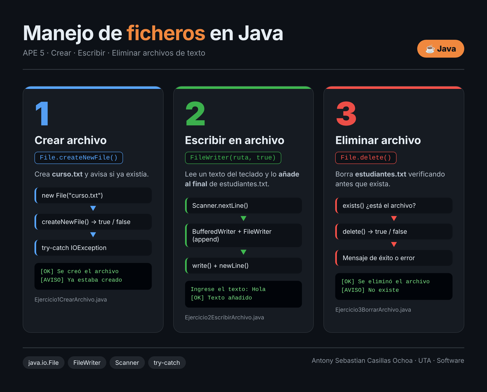

<div align="center">

# 📁 APE 5 · Manejo de ficheros en Java

**Crear · Escribir · Eliminar archivos de texto**


</div>

---

## 👤 Datos académicos

| | |
|---|---|
| **Estudiante** | Antony Sebastian Casillas Ochoa |
| **Universidad** | Universidad Técnica de Ambato |
| **Facultad** | Ingeniería en Sistemas, Electrónica e Industrial |
| **Carrera** | Software |
| **Asignatura** | Algoritmos y Lógica de Programación |
| **Docente** | Ing. José Caiza |
| **Periodo** | Julio – Diciembre 2026 |

---

## 🖼️ Infografía



---

## 🎯 Objetivo

Aprender a trabajar con archivos de texto en Java usando las clases de `java.io`: crear un archivo, escribir información en él sin perder lo anterior y eliminarlo, controlando los errores con `try-catch`.

## 🗂️ Estructura del proyecto

```
APE5/
├── Ejercicio1CrearArchivo.java
├── Ejercicio2EscribirArchivo.java
├── Ejercicio3BorrarArchivo.java
├── APE5_Ejercicios_Ficheros_Java.docx   (informe)
├── APE5_Ejercicios_Ficheros_Java.pdf    (informe en PDF)
├── APE5_Portada.docx
├── docs/
│   └── infografia.png
└── README.md
```

---

## 🧩 Ejercicios

### 1️⃣ Crear un fichero · `Ejercicio1CrearArchivo.java`

Crea el archivo **`curso.txt`**.

- `new File("curso.txt")` representa el archivo.
- `createNewFile()` devuelve `true` si lo creó y `false` si ya existía.
- `getAbsolutePath()` muestra dónde quedó.
- `try-catch` controla la `IOException`.

```
[OK] Se creó el archivo: curso.txt
[AVISO] El archivo curso.txt ya estaba creado.
```

### 2️⃣ Escribir en un fichero · `Ejercicio2EscribirArchivo.java`

Lee un mensaje por teclado y lo guarda en **`estudiantes.txt`**.

- `Scanner` captura el texto.
- `FileWriter(ruta, true)` abre el archivo en modo **append**: agrega al final sin borrar lo anterior.
- `BufferedWriter` escribe con `write()` y `newLine()`.
- `try-with-resources` cierra los recursos automáticamente.

```
Ingrese el texto a guardar: Hola, esta es mi primera línea
[OK] El texto se añadió al final de estudiantes.txt
```

### 3️⃣ Eliminar un fichero · `Ejercicio3BorrarArchivo.java`

Elimina el archivo **`estudiantes.txt`**.

- `exists()` verifica que el archivo esté antes de borrar.
- `delete()` devuelve `true` si lo eliminó.
- Si falla, se avisa que puede ser por permisos o porque está abierto.

```
[OK] Se eliminó el archivo estudiantes.txt
[AVISO] El archivo estudiantes.txt no existe, no hay nada que borrar.
```

---

## ▶️ Cómo ejecutar

Requisito: tener instalado el **JDK 17 o superior** (`java -version` para comprobarlo).

```bash
# 1. Compilar
javac *.java

# 2. Ejecutar cada ejercicio
java Ejercicio1CrearArchivo
java Ejercicio2EscribirArchivo
java Ejercicio3BorrarArchivo
```

> 💡 Orden recomendado: ejecuta el 1, luego el 2 (varias veces para ver cómo se acumulan las líneas) y por último el 3.

---

## 📚 Conceptos clave

| Clase / método | Para qué sirve |
|---|---|
| `File` | Representa un archivo o ruta en el sistema |
| `createNewFile()` | Crea el archivo si no existe |
| `exists()` | Comprueba si el archivo existe |
| `delete()` | Elimina el archivo |
| `FileWriter(ruta, true)` | Escribe en modo *append* |
| `BufferedWriter` | Escritura eficiente por líneas |
| `Scanner` | Lectura de datos por teclado |
| `try-catch` / `try-with-resources` | Manejo de errores y cierre automático |

## ✅ Conclusiones

- `File` permite crear, comprobar, ubicar y eliminar archivos con pocos métodos.
- El modo *append* de `FileWriter` conserva el contenido anterior y solo agrega información nueva.
- Capturar la `IOException` y verificar con `exists()` evita que el programa se detenga de forma inesperada.

---

<div align="center">

Hecho con ☕ por **Antony Sebastian Casillas Ochoa** · UTA – Carrera de Software · Noviembre 2026

</div>
